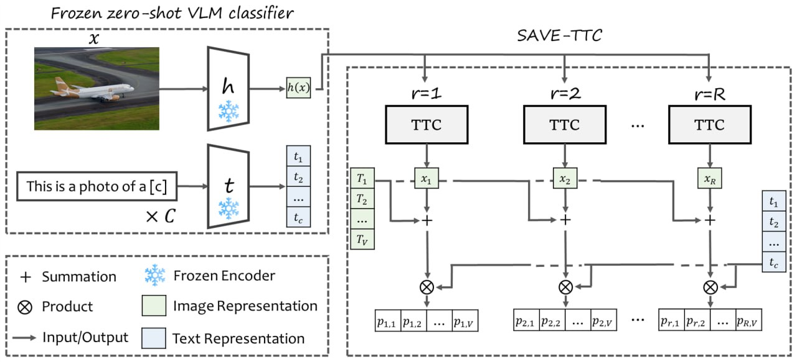

# SAVE-TTC: Stabilizing Test-Time Adversarial Defense for Vision-Language Models via Start-and-View Ensembling

**Mohammad Mahdi Babaafzali, Mohammad Javad Nasri-Lowshani, Fereshte Dehghani\***
Department of Electrical and Computer Engineering, University of Kashan
\*Corresponding author: fdehghani@kashanu.ac.ir

*MVIP 2026* · Paper: *link will be added after publication* · [Citation](#citation)

Official code for SAVE-TTC, an inference-time ensemble for CLIP. It combines independently initialized
Test-time Counterattack (TTC) trajectories with fixed post-counterattack image views and averages their class
probabilities. The frozen CLIP classifier and the original TTC optimization rule are kept unchanged; nothing
is retrained.



## Method

TTC ([Xing et al., CVPR 2025](https://github.com/Sxing2/CLIP-Test-time-Counterattacks)) runs a label-free,
bounded counterattack that moves the CLIP image feature away from that of the attacked input. A feature-drift
statistic τ gates the search, which starts from a single random perturbation, so the prediction can depend on
that initialization. SAVE-TTC executes **R** independent, unchanged TTC trajectories, applies **V**
predetermined transformations to each completed output, and averages the **R·V** class-probability vectors
(Algorithm 1 in the paper):

```text
a = h(x); s = 0
for r = 1..R:
    δ0 ~ U[-ε_c, ε_c]^d                     # independent start (seeded per image and restart)
    compute the gate statistic τ_r
    if τ_r < τ0: run N signed projected-ascent steps
    form x_r with the gated trajectory weights
    for v = 1..V:
        s += p(T_v(x_r))                    # post-softmax probabilities
p̄ = s / (R·V);  ŷ = argmax p̄
```

A configuration is written **R/V/N** (starts/views/steps). `1/1/2` is the TTC baseline and the default
SAVE-TTC is `3/9/4`: 12 counterattack updates and 27 classification passes per image. Hyperparameters:
ε_c = 4/255, α_c = 1/255, τ₀ = 0.2, β = 2. The V = 9 view family contains the identity, a horizontal
reflection, four 87.5% corner crops resized to 224 × 224, and reflections of the first three crops
(`views_code9` in [`savettc/core.py`](savettc/core.py)).

## Repository layout

```text
savettc/          the method (core.py) plus CLIP loading, cache I/O and timing helpers
scripts/          build_cache.py, evaluate.py, benchmark_runtime.py, make_tables.py, demo.py
configs/          YAML settings for the experiments
reproduce/        one-command reproduction (bash and PowerShell)
tests/            parity tests against the reference TTC implementation
third_party/ttc/  files from the official TTC repository (see third_party/README.md)
```

## Installation

Python ≥ 3.9 and a CUDA GPU are recommended (8 GB is enough). We used PyTorch 2.12 with CUDA 12.6 on an
RTX 3070 Ti.

```bash
git clone https://github.com/MehdiBabaafzali/SAVE-TTC.git
cd SAVE-TTC
pip install -r requirements.txt     # install the PyTorch build for your CUDA version first
```

The CLIP ViT-B/32 weights are downloaded automatically on first use.

## Data

Evaluation uses the test splits of **Oxford-IIIT Pets**, **Flowers102**, **FGVC-Aircraft** and **DTD**
(15,031 images in total). They are downloaded automatically through torchvision into `data/` the first time
you build the adversarial cache. `SAVETTC_DATA`, `SAVETTC_CACHE` and `SAVETTC_OUT` change the data, cache
and output locations (defaults `data/`, `caches/`, `outputs/`).

## Quick start

```bash
# classify one image with CLIP, TTC and SAVE-TTC, before and after a PGD attack on CLIP
python scripts/demo.py --image my_cat.jpg --classes "cat,dog,rabbit,hamster" --attack
```

```python
from savettc import SaveConfig, save_predict
from savettc.clip_model import load_clip, make_classifier
from savettc.paths import add_ttc_to_path

add_ttc_to_path()
model, prompt_token = load_clip()
clf = make_classifier(model, prompt_token, ["A photo of a cat.", "A photo of a dog."])
out = save_predict(clf, images, SaveConfig.from_rvn("3/9/4"), image_ids=range(len(images)))
pred = out.probs.argmax(1)  # images: float tensor in [0, 1], shape (B, 3, 224, 224)
```

## Running the experiments

The code implements the paper's **standard protocol** (following TTC): untargeted l∞ PGD with 10 steps,
ε_a = 1/255 and step size 1/255 against vanilla CLIP ViT-B/32, with the dataset-specific TTC prompts.
`build_cache.py` stores one adversarial set per dataset, so every configuration and defense seed is evaluated
on exactly the same attacked images (the shared-cache setting of Sec. V-A).

```bash
bash reproduce/main_table.sh       # cache + TTC / 2/9/4 / 3/9/4 / 1/9/20 over 3 defense seeds + clean accuracy
bash reproduce/ablation_grid.sh    # start/view ablation (Table V configurations)
bash reproduce/runtime.sh          # latency and memory (Table VI configurations)
```

On Windows use the matching `reproduce/*.ps1`. The individual steps are:

```bash
python scripts/build_cache.py                                  # downloads data, attacks CLIP; ~6.5 GB of caches
python scripts/evaluate.py --config configs/main_table.yaml    # resumable; writes outputs/summary/eval.jsonl
python scripts/evaluate.py --configs 1/1/2 3/9/4 --datasets Pets --max_images 64   # quick check
python scripts/benchmark_runtime.py --config configs/runtime.yaml
python scripts/make_tables.py                                  # aggregates everything into outputs/tables/
```

`evaluate.py` also writes per-image predictions (`outputs/per_image/`) for paired significance tests.

## Results (from the paper)

All numbers are top-1 accuracy (%) with a frozen CLIP ViT-B/32.

**Standard protocol, PGD-10, ε_a = 1/255** (Table I; the full table with training-based and other
training-free defenses is in the paper):

| Method | Pets | Flowers102 | Aircraft | DTD | Avg. |
|---|---:|---:|---:|---:|---:|
| CLIP (clean) | 87.44 | 65.46 | 20.10 | 40.64 | 53.41 |
| CLIP (attacked) | 1.04 | 1.14 | 0.00 | 2.98 | 1.29 |
| TTC (published) | 57.24 | 38.98 | 14.52 | 27.98 | 34.68 |
| **SAVE-TTC (ours)** | **86.05** | **64.12** | **20.25** | **39.57** | **52.50** |

**Ablation** (Table V; Δ is measured from the locally reproduced TTC baseline):

| Setting | R/V/N | Pets | Flowers102 | Aircraft | DTD | Avg. | Δ |
|---|---|---:|---:|---:|---:|---:|---:|
| Baseline | 1/1/2 | 57.78 | 39.16 | 13.59 | 28.03 | 34.64 | – |
| Starts | 3/1/2 | 60.75 | 41.86 | 15.24 | 28.62 | 36.62 | +1.98 |
| Views | 1/9/2 | 82.20 | 59.00 | 18.06 | 36.06 | 48.83 | +14.19 |
| Start+view | 3/9/2 | 82.72 | 59.55 | 18.12 | 36.01 | 49.10 | +14.46 |
| Views+N=4 | 1/9/4 | 86.26 | 62.95 | 19.23 | 38.67 | 51.78 | +17.14 |
| **SAVE-TTC** | **3/9/4** | 86.05 | 64.12 | 20.25 | 39.57 | **52.50** | **+17.86** |

View aggregation supplies most of the gain; multiple starts add a smaller complementary improvement.
Table I and Table V were produced with adversarial inputs regenerated for each run. On a **shared PGD-10
cache** (15,031 images, three defense seeds; Sec. V-A, which is what `reproduce/main_table.sh` runs),
SAVE-TTC 3/9/4 averages **52.56 ± 0.08**, the two-start 2/9/4 reaches 52.46 ± 0.15 at a lower cost, and the
deeper single-start 1/9/20, at similar latency to 3/9/4, reaches 50.80 ± 0.14.

**Inference cost** on Pets (Table VI; RTX 3070 Ti, fp32, batch size 8, peak allocated GPU memory including
the model and text features):

| Config | R/V/N | Updates | Views | ms/img | Mem. (MB) |
|---|---|---:|---:|---:|---:|
| TTC | 1/1/2 | 2 | 1 | 8.6 | 1038 |
| Views | 1/9/2 | 2 | 9 | 17.4 | 1038 |
| Single start | 1/9/4 | 4 | 9 | 23.7 | 1047 |
| Two starts | 2/9/4 | 8 | 18 | 45.1 | 1060 |
| Deep single | 1/9/20 | 20 | 9 | 70.0 | 1121 |
| **SAVE-TTC** | **3/9/4** | 12 | 27 | 67.0 | 1060 |

The paper additionally reports a PGD-100 protocol (ε_a = 4/255) with 43.44 ± 0.09% mean accuracy over three
runs; that separately reproduced evaluation pipeline is not part of this repository.

## Threat model and limitations

The results above concern attacks generated for undefended CLIP and transferred to SAVE-TTC. The paper also
tests a defense-aware PGD-100 attack at ε_a = 4/255 using BPDA/EOT, which queries the full randomized 3/9/4
ensemble: accuracy falls to **0%** on the tested stratified subsets (Table VII). That finding applies to those
subsets and that budget, not necessarily to full test sets or ε_a = 1/255. SAVE-TTC should not be regarded as
robust to adaptive white-box attackers, and this repository makes no certified or universal robustness claim.

## Tests

```bash
pytest -q tests
```

The tests compare `savettc/core.py` against the reference TTC implementation
([`tests/reference_impl.py`](tests/reference_impl.py)): preprocessing, views, the counterattack with both gate
states, and full SAVE-TTC predictions given identical random starts. They also check the l∞ and [0, 1]
constraints, seeding, batching and mixed precision. The tests use the Pets cache if it exists and synthetic
images otherwise.

## Citation

```bibtex
@inproceedings{babaafzali2026savettc,
  title     = {{SAVE-TTC}: Stabilizing Test-Time Adversarial Defense for Vision-Language Models via
               Start-and-View Ensembling},
  author    = {Babaafzali, Mohammad Mahdi and Nasri-Lowshani, Mohammad Javad and Dehghani, Fereshte},
  booktitle = {Proceedings of the International Conference on Machine Vision and Image Processing (MVIP)},
  year      = {2026}
}
```

Please also cite TTC, which SAVE-TTC builds on:

```bibtex
@inproceedings{xing2025clip,
  title     = {{CLIP} is Strong Enough to Fight Back: Test-time Counterattacks towards Zero-shot
               Adversarial Robustness of {CLIP}},
  author    = {Xing, Songlong and Zhao, Zhengyu and Sebe, Nicu},
  booktitle = {Proceedings of the IEEE/CVF Conference on Computer Vision and Pattern Recognition (CVPR)},
  year      = {2025}
}
```

## Acknowledgements

The counterattack, the prompt-capable CLIP and the dataset loaders come from the
[official TTC repository](https://github.com/Sxing2/CLIP-Test-time-Counterattacks) (see
[`third_party/README.md`](third_party/README.md)), which builds on [OpenAI CLIP](https://github.com/openai/CLIP).

## License

The code in this repository is released under the [MIT License](LICENSE), except `third_party/`, which keeps
the terms of its original authors.
